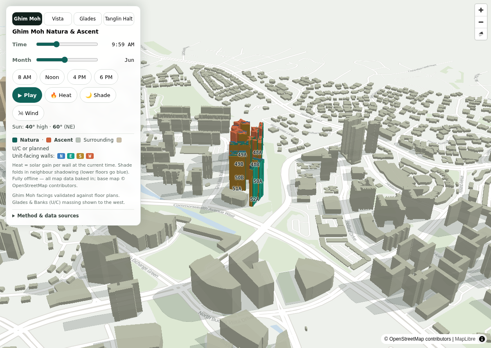

# HDB 3D: sun, heat and wind

Live: **https://sbf-queenstown-feb-2026.outsites.app/**

One self-contained HTML file (12 MB, works offline once loaded). Four HDB launch projects in Queenstown are drawn in 3D among about a thousand real neighbouring buildings. Slide the time of day and the month and watch the facade lighting and ground shadows move. Toggle:

- **Heat**: solar gain per wall band at the selected time (red hot, blue cool)
- **Shade**: folds in shadowing by neighbouring buildings, so lower floors behind a tall block go blue
- **Wind**: facade exposure to the prevailing monsoon wind for the selected month (teal windward, grey sheltered)



Built while choosing a flat in the February 2026 Sale of Balance Flats launch, because "which side gets the afternoon sun" is not something a brochure answers.

## What is in this repo

```
index.html          the page, byte-identical to the live site
screenshot.png
pipeline/           the generalised generator that built it (Python 3, no web framework)
  fetch_osm_buildings.py   Overpass query for footprints and heights in a bbox
  trace_pdf_footprint.py   trace a missing footprint from a brochure floor plan and georeference it
  build_sun_heat_map.py    context + targets + config -> the HTML, with the sun, shade and wind engine
  map_template.html        the template the builder fills
  verify_headless.py       load the file in headless Chromium, count rendered features, screenshot
  PIPELINE.md              the five-stage procedure
  notes/                   the solar maths and the MapLibre traps that cost real hours
```

The GeoJSON inputs for this particular page (the traced footprints, storey counts and unit facings) are not included, so the pipeline documents how the page was built rather than rebuilding it with one command. Point the scripts at your own bbox and targets.

## Method, briefly

- **Sun position** is computed in the browser from standard solar geometry (Cooper declination, equation of time, clock to true solar time using the site longitude against the UTC+8 meridian, which is why solar noon here is about 13:10). Checked against the NREL Solar Position Algorithm via pvlib: max error 1.2 degrees over the tested dates and times.
- **Heat** is a relative clear-sky solar-gain index per wall band: direct-beam strength with simple air-mass extinction, times the incidence factor on a vertical wall. No clouds, reflections or diffuse sky.
- **Shade** casts a ray from each wall band toward the sun against every neighbouring building at least 22 m tall within 250 m. A blocked band keeps a 12% residual for diffuse light. Ground shadows are each footprint projected h·cot(elevation) away from the sun azimuth.
- **Wind** uses a monsoon climatology estimate of the monthly prevailing surface-wind direction (NE monsoon Dec to Mar, SW monsoon Jun to Sep with mostly southeasterly surface winds, light and variable in between), cross-checked against data.gov.sg station readings. Exposure is the cosine between the facade normal and the wind source. It is not a live reading and not CFD.
- **Verification**: the rendered colour of every facade band in all four projects was checked against an independent recomputation of the same physics, and the shadow geometry against independently computed projections. `verify_headless.py` confirms the layers actually draw; a clockwise polygon ring renders nothing in MapLibre with no error, so "it loaded" is not enough.

## Data and licences

- Building footprints and heights: OpenStreetMap, © OpenStreetMap contributors, ODbL. Includes the under-construction Ghim Moh, Ulu Pandan Vista and Tanglin Halt Cascadia blocks.
- Storey counts, unit facings and mixed-wing heights: the HDB sales brochures. Ulu Pandan Glades is not yet in OSM; its outline was traced from the brochure floor plans and georeferenced to the site plan, anchored to OSM roads and OneMap block positions (about ±2 m).
- Base map (roads, parks, water, rail): OpenStreetMap data rendered locally in the file; no tile service is called.
- MapLibre GL JS (BSD-3-Clause), Open Sans (Apache 2.0).
- Code in `pipeline/`: MIT.

## How it was built

With Claude Code, end to end: the first version was a conversation, the working pipeline was then turned into a reusable Claude Code skill (the scripts and notes in `pipeline/` are that skill, minus the front matter). The page is served as a static subdomain from the same nginx container as [outsites.app](https://outsites.app), behind a Cloudflare Tunnel.
